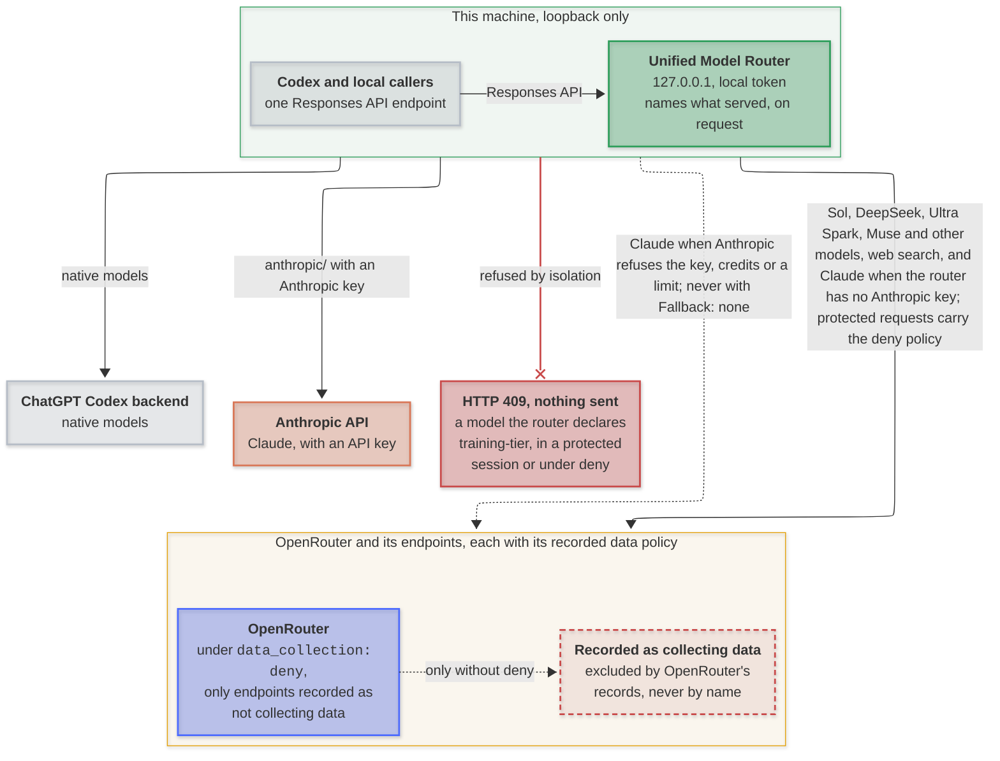

# Unified Model Router

[](https://github.com/mirzahusadzic/unified-model-router/actions/workflows/ci.yml)
[](LICENSE)


[](https://doi.org/10.5281/zenodo.24014211)

A loopback-only Responses API router: local programs get one endpoint for OpenAI, DeepSeek, Claude, Muse Spark and other OpenRouter models, with each session's history and privacy boundaries kept across model switches. Codex is its first client: the installer sets Codex up to switch models from its own picker within one thread, and Codex's requests are what the tests replay.

- **Claude on Anthropic's API:** With `ANTHROPIC_API_KEY`, Claude runs on the Messages API with prompt caching and signed thinking, and moves to OpenRouter if the key, credits or spend limit fail, unless the caller keeps it on Anthropic's API with `X-Codex-Router-Fallback: none` ([details](docs/routing.md#routing-policy)); without the key it runs on OpenRouter.
- **Agent orchestration:** Ultra Spark lets DeepSeek coordinate up to 10 Muse Spark workers with `fork_context: false`, on endpoints that do not train, or on Meta's cheaper training tier as Ultra Spark Contributor.
- **Privacy boundaries:** Training-tier sessions cannot mix with OpenAI, Claude, or non-training Ultra Spark sessions, and after any of them a session reaches only the OpenRouter endpoints that OpenRouter's records count as not collecting data.
- **Provider compatibility:** Repairs reasoning and tool history, handles DeepSeek JSON-mode structured output, normalizes problematic tool arguments, and never silently substitutes models.
- **Resilient streaming:** Bounded recovery for OpenRouter and Anthropic, context-overflow signaling for Codex compaction, router diagnostics, and disconnect cancellation.
- **Router-run web search:** Every model except native OpenAI ones searches through OpenRouter, and the results stay in the thread for later turns.
- **Local operations:** Loopback binding, token authentication, private credential storage, launchd/systemd/Windows startup, backups, verifiers, and daemon version pinning.
- **Minimal footprint:** Node.js 20+, zero npm runtime dependencies.

---

### How it works

Codex talks to the router as one model provider. The router picks the upstream from the model slug, adapts each request to that provider, and streams the response back. OpenAI and Claude models never share a tracked Codex session with models the router declares training-tier, and protected requests reach only endpoints that OpenRouter's own records count as not collecting data; requests without a session ID are not tracked. [How routing works](docs/routing.md#routing-and-compatibility) has the details.

**Key:** 🟢 router · 🔵 OpenRouter, for Sol, DeepSeek, Ultra Spark, Muse and other models · 🟡 OpenRouter's endpoints · 🟠 Anthropic · ⚪ callers and OpenAI · 🔴 refused or excluded; dashed lines are conditional.



<p align="center"><em>All requests go through the router; labels show the route. A dotted line is a path taken only on that condition, and a line ending in a cross is a refusal that sends nothing on.</em></p>

---

### Install

Requires Codex CLI (tested with **0.167.0**), **Node.js 20+**, and an **OpenRouter API key**. Windows also needs PowerShell 5.1 or later.

Skip the first command if you already have Codex 0.167.0. The first install asks for your OpenRouter API key:

```sh
npm install -g @openai/codex@0.167.0
git clone https://github.com/mirzahusadzic/unified-model-router.git
cd unified-model-router
node install.mjs
node install.mjs --verify
```

#### Keys

| Key | Serves |
| --- | --- |
| OpenRouter (required) | DeepSeek, Ultra Spark, Muse, and other OpenRouter models; Claude without an Anthropic key, or as its fallback; web search for every model except native OpenAI ones |
| Anthropic (optional) | Claude on Anthropic's API first; a thread keeps the route it started on ([which key when](docs/routing.md#claudes-two-routes)) |
| ChatGPT login | Native OpenAI models |

To add the Anthropic key, create an API key at [platform.claude.com](https://platform.claude.com/), put `ANTHROPIC_API_KEY=<the key>` in `~/.codex/unified-router/openrouter.env`, which the installer keeps, and rerun `node install.mjs`. Despite its name, the file holds every provider's key, and the router sends each key only to its own provider.

`install.mjs` runs the installer for your platform from [`platform/`](platform/README.md). Common variations:

| To | Run |
| --- | --- |
| Replace the stored OpenRouter key; it asks for the new one | `node install.mjs --change-api-key` |
| Read the key from a file instead of asking | `node install.mjs --api-key-file ~/openrouter.key` |
| Hide native OpenAI models from `/model` | `CODEX_ROUTER_NATIVE_MODELS=hide node install.mjs` |
| Keep Codex analytics on | `CODEX_ROUTER_DISABLE_ANALYTICS=0 node install.mjs` |
| Let shell commands reach the network without asking | `CODEX_ROUTER_SANDBOX_NETWORK=1 node install.mjs` |

On an existing Codex configuration, the installer asks before merging into it and backs it up first. By default, it also hides native OpenAI models when Codex's login shows no active ChatGPT plan, turns off Codex analytics, ChatGPT connector tools, and the guardian that sends transcripts to OpenAI for review, and allows 10 parallel agents. `node install.mjs --help` summarizes the options; [Installer settings](docs/setup.md#installer-settings) explains each one with its default.

**Start a new thread after installation.** The installer restarts a running Codex app-server daemon for you and pins it to the CLI's Codex, so it no longer updates itself to versions the router has not been tested with ([why](docs/setup.md#daemon-updates)); restart other open Codex windows yourself ([details](docs/setup.md#activate-the-provider)).

---

### Use

Start Codex with the default, DeepSeek V4.1 Flash 1017, or pick another model with `-m`:

```sh
codex
codex -m ultra-spark-private/deepseek-v4.1-flash-1017
codex -m ultra-spark/deepseek-v4.1-flash-1017
codex -m openrouter/meta/muse-spark-1.3-contributor
codex -m openrouter/openai/gpt-6.1-sol
codex -m anthropic/claude-fable-5-2
codex -m anthropic/claude-opus-5-5
codex -m anthropic/claude-sonnet-5-5
```

| Model | Best for |
| --- | --- |
| **DeepSeek V4.1 Flash 1017** (default) | Everyday agentic coding with a long context. [Details](docs/setup.md#deepseek-context-window) |
| **DeepSeek · Ultra Spark** | Strong for code audits, deep reviews, and changes across many files. No endpoint in its session trains on inputs, so it fits private code. [Details](docs/setup.md#ultra-spark-mode) |
| **DeepSeek · Ultra Spark Contributor** | The same, but Meta trains on its workers' inputs, so it fits public code only; cheaper. [Details](docs/setup.md#ultra-spark-contributor) |
| **Muse Spark 1.3** | Muse on private code: its endpoint does not train on inputs, at a higher price. [Details](docs/setup.md#muse-spark-13) |
| **Muse Spark 1.3 Contributor** | Fast, inexpensive work on public code. [Details](docs/setup.md#muse-spark-13-contributor) |
| **GPT-6.1 Sol (OpenRouter)** | Strong for text comprehension and rewriting at `xhigh`. Runs on OpenRouter credit, without a ChatGPT plan; the native model keeps its own name. [Details](docs/setup.md#gpt-61-sol) |
| **Claude Fable 5.2 · Claude Opus 5.5 · Claude Sonnet 5.5** | Hard problems that need Anthropic's models; prompt caching keeps long threads affordable. Runs on Anthropic's API when you add `ANTHROPIC_API_KEY` to the [router settings](docs/setup.md#router-settings), otherwise on OpenRouter. [Details](docs/setup.md#claude-sonnet-55-opus-55-and-fable-52) |
| **Any `openrouter/<vendor>/<model>`** | Trying another model; [add a catalog entry](docs/setup.md#add-a-model) to list it in `/model`. |
| **Native OpenAI**, such as `gpt-6-astra` | Requires a ChatGPT plan. |

Muse Spark 1.3 Contributor and Ultra Spark Contributor's workers use Meta's contributor tier, which trains on everything it receives, so use them only for code you are willing to share. DeepSeek's own endpoint may train on prompts too; after an OpenAI or Claude model, or in a non-training Ultra Spark session, a session's OpenRouter requests go only to endpoints that keep no data, so pin DeepSeek to one to use it there. The router refuses to mix them with OpenAI, Claude, or non-training Ultra Spark models in a tracked Codex session; requests without a session ID are not tracked ([details](docs/routing.md#provider-isolation)).

Without a ChatGPT login, add `--profile unified-openrouter` to any of the commands above, Ultra Spark included ([details](docs/setup.md#openrouter-only-profile)). To prefer specific OpenRouter endpoints, set [`CODEX_ROUTER_PROVIDER_ORDER`](docs/setup.md#openrouter-endpoint-preferences).

---

### Cite

The working paper on Zenodo describes the router as a narrow waist: one protocol and one policy point between local clients and their providers. The paper is under CC BY 4.0 and the code under Apache-2.0; the paper's DOI always resolves to its latest version:

```bibtex
@misc{husadzic2026junction,
  author    = {Husadzic, Mirza},
  title     = {Policy at the Junction: The Unified Model Router
               as a Narrow Waist},
  year      = {2026},
  publisher = {Zenodo},
  note      = {Working paper},
  doi       = {10.5281/zenodo.24014211},
  url       = {https://doi.org/10.5281/zenodo.24014211}
}
```

---

### Develop

```sh
node --test
```

CI tests Linux, macOS, and Windows, checks script syntax, and validates the model catalog. Tests need no API keys or network access.

---

[Configuration](docs/setup.md) · [How routing works](docs/routing.md) · [Services & troubleshooting](docs/operations.md) · [Contributing](CONTRIBUTING.md) · [Security](SECURITY.md) · [Apache-2.0](LICENSE) · [Notices](NOTICE)
